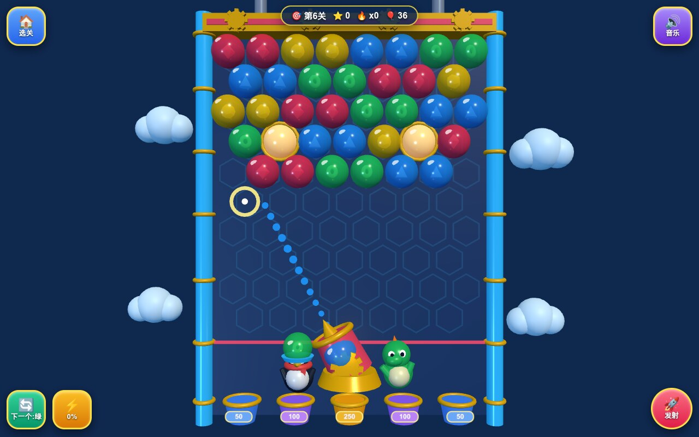

# 🐉 QQ泡泡龙 3D — QQ Bubble Dragon Shooter 3D

**Live Playable Demo:** [https://kunruiw1991.github.io/qq-bubble-dragon-3d/](https://kunruiw1991.github.io/qq-bubble-dragon-3d/)



A vibrant, glossy **Three.js r170 WebGL2 3D** remake of Tencent QQ Game Hall's classic **QQ泡泡龙 (*Puzzle Bobble*)**, crafted for both young kids on iPad touchscreens and nostalgic desktop arcade players.

---

## ✨ Authentic Gameplay & 3D Arcade Features

1. **3D Crystal-Arcade Stage, Geared Brass Cannon & Chibi Crew**:
   - **Bevelled 3D Crystal Side Rails** with golden bands and elastic wall-ricochet physics.
   - **Descending Geared Compressor Ceiling Bar** with 4 animated 3D brass cogwheels and twin piston shafts.
   - **5 Glowing 3D Bonus Cauldrons (`50 / 100 / 250 / 100 / 50`)** arrayed along the arcade floor.
   - **Geared Brass-and-Candy 3D Bubble Launcher Cannon** operated by a bespoke **3D Chibi Bubble Dragon (`泡泡小恐龙`)** and **3D QQ Penguin Co-Pilot (`QQ小企鹅`)** manning the crystal **Next-Bubble Feeder Pad (`换球台`)**.
   - **Glossy Translucent Inner-Emblem Candy Bubbles**: Every bubble features a translucent candy shell, cartoon highlight dome, and a distinct 3D inner emblem (`Ruby Octahedron`, `Golden Star`, `Ocean Teardrop`, `Emerald Clover`, `Amethyst Knot`, `Tangerine Sun-Wheel`) so colors are 100% distinguishable by both hue and 3D shape.

2. **Exact Offset Hex-Grid Physics, 3+ BFS Pop & Ceiling-Detachment Avalanche (`掉落加分`)**:
   - **120Hz Substepped Flight & Elastic Wall Ricochet**: Aim clamped cleanly (`-78°` to `+78°`) with a live **3D Pearl Trajectory Preview Ray** (including wall-bounce reflection) and **3D Ghost Hex Snap Ring** guaranteed to match the actual landing hex cell.
   - **Deterministic Hex Snap**: Even rows (`8` columns) and odd half-offset rows (`7` columns) with zero overlapping cells, zero out-of-bounds snaps, and zero floating unanchored snaps.
   - **3+ Connected Color BFS & Ceiling-Anchor Avalanche**: Matching `>= 3` connected same-color bubbles pops them with 3D burst particles, then immediately runs a ceiling-anchor BFS from `row === 0` so all unanchored floating islands detach simultaneously and rain into the **5 Bonus Cauldrons (`50 / 100 / 250 / 100 / 50`)** with cascading marimba chimes.
   - **Smart Remaining-Color Shooter Filter**: Only colors still present on the board spawn in the launcher during stage clearing.

3. **Bubble Swap (`换球`) & 3 Special Bubbles (`必杀泡泡`)**:
   - **Swap Current / Next Bubble (`换球`)**: Tap the 3D QQ Penguin feeder pad, tap the `🔄 换球` HUD button, or press `S` / `Shift`.
   - **Bomb Bubble (`炸弹泡泡`)**: Blasts a 2-hex radius crater on impact.
   - **Rainbow Bubble (`彩虹泡泡`)**: Universal wildcard that matches and pops all adjacent bubble color clusters simultaneously.
   - **Star Lightning Bubble (`闪电泡泡`)**: Zaps and clears the entire horizontal row on impact.

4. **2 Game Modes & 20 Progressive Stages**:
   - **20 Progressive Stages (`闯关模式`)**: Combines classic **Clear All** stages and **Star-Critter Dragon Egg Rescue (`星星龙蛋营救`)** stages, culminating in a **3D Top-3 Star Podium (`★★★`)**.
   - **Endless Arcade (`无尽挑战`)**: Continuous survival mode where new bubble rows feed from the top ceiling while you chain massive cauldron avalanches.

---

## 🎮 Controls (iPad Touch & Desktop Keyboard)

| Input | Action |
| :--- | :--- |
| **Touch / Mouse Drag on 3D Stage** | 1:1 continuous aim with live 3D pearl trajectory & ghost snap ring; **release to fire** |
| **Tap 3D QQ Penguin / `🔄 换球` Button / `S` / `Shift`** | Swap Current & Next Bubble |
| **`🚀 发射` Button / `Space` / `ArrowUp` / `Enter`** | Fire Bubble |
| **`ArrowLeft` / `ArrowRight` / `A` / `D`** | Fine-adjust Cannon Aim Angle |
| **`⚡ 必杀` Button / `E`** | Activate / Equip Special Bubble (`Bomb` / `Rainbow` / `Lightning`) |
| **`🔊 音乐` Button / `M`** | Toggle WebAudio Synthesized Arcade BGM & SFX |
| **`🏠 选关` Button** | Open Stage & Mode Selection Menu |

---

## 🫧 Changelog — Fun Overhaul (v1.1)

The first release was a correct bubble shooter with no stakes: 8 tiny stages ended in ~10 shots, the
chamber had only ≈8.8 rows of air, the lose screen still offered "下一关", and pops were polite.

- **Taller chamber, real room to play** — ceiling 5.4 → 6.0, danger line −2.2 → −2.9 (≈10.3 rows of
  air), launcher lowered, cauldrons 0.8×; the camera fills ≈92 % of the viewport height and bubbles
  are ≈63 px at 1280×800.
- **20 stages with a real curve** — the 8 hand-made boards plus 12 generated ones (stripes, checker,
  double-arch, pyramid, egg-nest, zigzag) with colours ramping 3 → 4 → 5 → 6, eggs nested at row ≥ 3
  behind ≥ 5 multi-colour neighbours, every board anchored across the whole ceiling (a single pop can
  detach ≤ 8 % of a board). Measured with a greedy bot: stage 1 in 8–10 shots, stage 14 in ~12,
  stage 20 in ~24; a random shooter still loses every stage within 60 shots. Progress and stars persist
  in `localStorage['qq_bubble_progress']`; stage 20's clear button launches Endless (♾️ 挑战无尽).
- **Juice** — 14 particles + expanding rings + camera shake per pop, per-bubble rising pitch, ≥ 4
  dropped bubbles trigger 0.4 s slow-mo and "雪崩 ×N!", cauldron catches fire a coin fountain and the
  dragon jumps, combos make the crew cheer, "PERFECT!" for ≤ par clears, sparkles + chirp on egg rescue.
- **Honest lose/clear flow** — no more 3D podium blocks floating over the board; a sad crew + "再来一局"
  on a loss (no 下一关), stars + 下一关 on a clear with the board emptied as bonus drops.
- Stage-select cells ≥ 52×44 px, HUD text ≥ 16 px, launcher label "下一个:<colour>", ≤ 5 controls.
- Writes `localStorage['qq_hall_progress'].bubbledragon` for the QQ Game Hall 3D progress badges.
- E2E suite grown from 34 to 45 tests (geometry, generator determinism and anchoring, difficulty
  table across all 20 stages, slow-mo, lose/clear flows, unlock persistence, 4-viewport audits).

---

## 🧪 Local Development & Headless WebGL2 E2E Verification

Zero build step or bundler is required; all ES modules use Safari-safe relative paths (`./src/*.js`, `../vendor/three.module.min.js`) with zero `<script type="importmap">`.

```bash
# Serve locally
python3 -m http.server 8080

# Run the full 45-test headless Chrome WebGL2 E2E test suite
python3 tests/run_e2e.py --capture-screenshot
```
